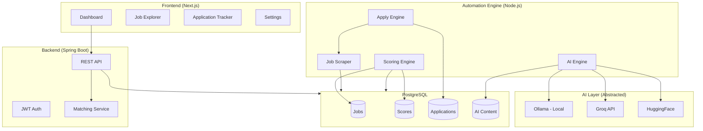

<div align="center">

# 🎯 JobFlow AI

**Intelligent Job Application Workflow Engine**

An AI-powered system that finds, matches, and applies to jobs with precision — not spam.

[](https://www.typescriptlang.org/)
[](https://nextjs.org/)
[](https://spring.io/projects/spring-boot)
[](https://www.postgresql.org/)
[](https://playwright.dev/)
[](LICENSE)

[Live Demo](#demo) · [Documentation](#architecture) · [Installation](#quick-start) · [Contributing](#contributing)

</div>

---

## The Problem

Job hunting is broken:
- Applying manually to 50+ jobs/day is exhausting
- Generic applications get ignored
- Tracking applications across platforms is chaos
- Mass-apply bots get you banned and produce garbage

## The Solution

JobFlow AI is a **selective, intelligent** application system. It:

1. **Finds** relevant jobs from Naukri & LinkedIn
2. **Scores** each job against your profile using a 5-dimension algorithm
3. **Generates** tailored resumes and cover letters using AI
4. **Applies** only to high-match jobs (75+ score) with human-like behavior
5. **Tracks** everything in a clean dashboard

**Key principle**: Quality over quantity. 10 perfect applications > 100 generic ones.

---

## Architecture



---

## Features

### Intelligent Job Matching
| Dimension | Weight | How It Works |
|-----------|--------|--------------|
| Skill Match | 40% | Synonym-aware comparison (springboot = spring boot) |
| Experience | 20% | Range-based with flex tolerance |
| Location | 15% | City/region/remote classification |
| Salary | 15% | Range overlap with configurable flexibility |
| Recency | 10% | Time-decay scoring (fresh = better) |

### AI Content Generation
- **3 providers, 1 interface** — Ollama (free local), Groq (fast), HuggingFace (fallback)
- Resume bullets tailored to each job's requirements
- Cover letters that reference specific company/role details
- Application answers that highlight relevant experience
- Quality scoring and post-processing (removes AI artifacts)

### Safety-First Automation
```
Score ≥ 75 → Daily limit check → Duplicate prevention →
Manual approval → Human-like delays → Form fill → Submit → Track
```

| Safety Gate | Purpose |
|-------------|---------|
| Score threshold (75+) | Only apply to strong matches |
| Daily limit (15 Naukri, 8 LinkedIn) | Prevent account flags |
| SHA256 dedup hash | Never apply twice |
| Manual approval mode | Human in the loop |
| Random delays (1-5 min) | Simulate human behavior |
| Dry-run mode | Test without submitting |
| Session validation | Never trigger re-login loops |

---

## Tech Stack

| Layer | Technology | Why |
|-------|-----------|-----|
| Frontend | Next.js 14, TypeScript, Tailwind | App Router, server components, fast |
| Backend | Spring Boot 3, Java 17 | Enterprise-grade API, JWT auth |
| Automation | Playwright, Node.js | Stealth browser control |
| Database | PostgreSQL 16 | JSONB, full-text search, robust |
| AI | Ollama + Groq + HuggingFace | Zero-cost with smart fallback |
| Deploy | Docker, Vercel, Render | One-command deployment |

---

## Project Structure

```
smart-job-hunter/
├── frontend/                    # Next.js dashboard
│   ├── src/app/                 # App Router pages
│   ├── src/components/          # Reusable UI components
│   └── src/lib/                 # API client, types
├── backend/                     # Spring Boot API
│   ├── src/main/java/           # Controllers, services, repos
│   └── Dockerfile
├── automation-service/          # Core engine (Node.js + Playwright)
│   ├── src/
│   │   ├── auth/                # Session management
│   │   ├── jobs/                # Scraping + parsing
│   │   ├── matching/            # Scoring algorithm
│   │   ├── ai/                  # AI provider abstraction
│   │   ├── apply/               # Auto-apply engine
│   │   ├── platforms/           # Naukri + LinkedIn adapters
│   │   ├── db/                  # PostgreSQL + migrations
│   │   └── utils/               # Logger, retry, monitoring
│   └── Dockerfile
├── docker-compose.yml           # Full stack orchestration
└── .env.example                 # All configuration documented
```

---

## Quick Start

### Prerequisites
- Node.js 20+
- Docker & Docker Compose
- (Optional) Ollama for local AI

### 1. Clone & Configure
```bash
git clone https://github.com/at2205/jobflow-ai.git
cd jobflow-ai
cp .env.example .env
# Edit .env with your credentials
```

### 2. Start Infrastructure
```bash
docker-compose up -d db ollama
docker-compose exec ollama ollama pull mistral
```

### 3. Run Automation Service
```bash
cd automation-service
npm install
npx ts-node src/index.ts migrate
```

### 4. Login & Start
```bash
# Save session (one-time)
npx ts-node src/index.ts login -p naukri

# Fetch jobs
npx ts-node src/index.ts fetch-jobs -p naukri -r "Java Developer" -l "Delhi NCR"

# Score them
npx ts-node src/index.ts score-jobs -u <user-id>

# Apply (dry run first!)
npx ts-node src/index.ts auto-apply -u <user-id> -p naukri --dry-run
```

### 5. Start Dashboard
```bash
cd frontend && npm install && npm run dev
# Open http://localhost:3000
```

---

## Demo

### Dashboard
> Job scores, application status, daily analytics at a glance

### Scoring Engine
```
Job: "Senior Java Developer" @ Flipkart
Score: 87/100

Breakdown:
  Skill:      95/100 — 9/10 skills matched
  Experience: 85/100 — 2yr fits 1-4yr range
  Location:   100/100 — Delhi NCR (exact match)
  Salary:     70/100 — 12 LPA slightly below 15 LPA expected
  Recency:    80/100 — Posted 3 days ago
```

### AI Generation
```
Generated cover letter (Groq, 1.2s):

Having architected Spring Boot APIs processing 10,000+ daily financial
transactions at Bankit, I bring exactly the production-scale Java experience
your senior developer role requires. My recent migration of legacy Struts
systems delivered 25% performance improvements — the kind of modernization
mindset that drives engineering excellence at Flipkart...
```

---

## Deployment

| Service | Platform | Cost |
|---------|----------|------|
| Frontend | Vercel | Free |
| Backend | Render | Free → $7/mo |
| Database | Supabase | Free (500MB) |
| Automation | Hetzner VPS | $4/mo |
| AI (Ollama) | Same VPS | $0 |
| **Total** | | **$4-11/mo** |

```bash
# One-command production deploy
docker-compose -f docker-compose.prod.yml up -d
```

---

## Contributing

1. Fork the repository
2. Create your feature branch (`git checkout -b feature/amazing-feature`)
3. Commit your changes
4. Push to the branch
5. Open a Pull Request

See [CONTRIBUTING.md](CONTRIBUTING.md) for detailed guidelines.

---

## Roadmap

- [x] Naukri integration
- [x] LinkedIn Easy Apply
- [x] AI content generation (3 providers)
- [x] Intelligent scoring engine
- [x] Safety-gated auto-apply
- [x] Next.js dashboard
- [ ] Email notifications
- [ ] Indeed / Glassdoor support
- [ ] Interview scheduler
- [ ] Resume PDF export
- [ ] Chrome extension for manual boost

---

## License

MIT — use it, modify it, build on it.

---

<div align="center">

**Built by [Aryan Tomar](https://linkedin.com/in/aryan-tomar-02727128b)**

Java Backend Engineer | AI Agent Builder | Full-Stack Developer

</div>
